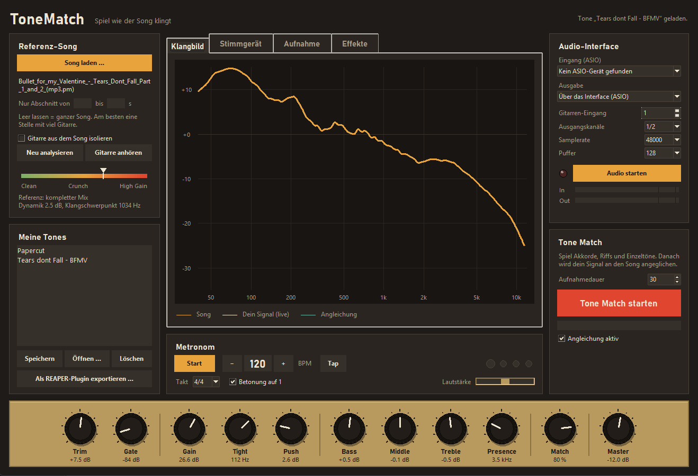

# ToneMatch

Play your guitar and sound like the song. ToneMatch analyzes a reference track, then processes your live guitar signal (via ASIO) so its tone gets as close as possible to the guitar in that song — no amp picking, no preset browsing.



## Features

- **Tone Match** – load a song (MP3, WAV, FLAC, M4A …), play for 30 seconds, and ToneMatch matches your sound to it
- **Guitar isolation** (optional) – separates the guitar from the mix with Demucs for a more accurate match
- **Amp simulation** – gain, tight, push, 3-band EQ, presence, noise gate
- **Effects** – overdrive, distortion, chorus, delay (tempo sync), reverb
- **Tuner, metronome and recorder** – records wet + dry (DI) tracks, with re-amping and a backing track without guitar
- **REAPER export** – turns any tone into a native JSFX plugin
- **Flexible audio routing** – ASIO input, with output either through the same interface or a separate device (e.g. USB headphones)

## Requirements

- Windows with an ASIO driver (your interface's driver or ASIO4ALL)
- Python 3.10+
- Optional: [ffmpeg](https://ffmpeg.org/) for M4A/AAC files, [Demucs](https://github.com/facebookresearch/demucs) for guitar isolation

## Installation

```bash
pip install -r requirements.txt
pip install demucs   # optional, for guitar isolation
```

## Usage

```bash
python tonematch_gui.py
```

### Windows EXE

Build a standalone app (no Python needed to run it):

```powershell
powershell -ExecutionPolicy Bypass -File build.ps1
```

Then start `dist\ToneMatch\ToneMatch.exe`. Ship the whole `dist\ToneMatch` folder (e.g. as a zip in a GitHub Release) – the EXE needs its `_internal` folder. Tones, recordings and stems are stored next to the EXE.

> Guitar isolation (Demucs/PyTorch) is not bundled in the EXE to keep it small; use the Python version for that.

### Quick start

1. Choose your ASIO device and click **Audio starten**
2. Load a song with **Song laden …**
3. Click **Tone Match starten** and play for about 30 seconds
4. Fine-tune with the knobs and save the result under **Meine Tones**

## Project structure

| File / folder | Purpose |
|---|---|
| `tonematch_gui.py` | User interface |
| `tonematch_core.py` | Audio engine, analysis, DSP and JSFX export |
| `ToneMatch.spec`, `build.ps1` | PyInstaller build for the Windows EXE |
| `docs/` | Screenshots |
| `tones/` | Saved tones |
| `recordings/` | Recordings (not tracked by git) |
| `stems/` | Cached guitar stems (not tracked by git) |
| `reference_files/` | Your own reference songs (not tracked by git) |

> The user interface is in German.